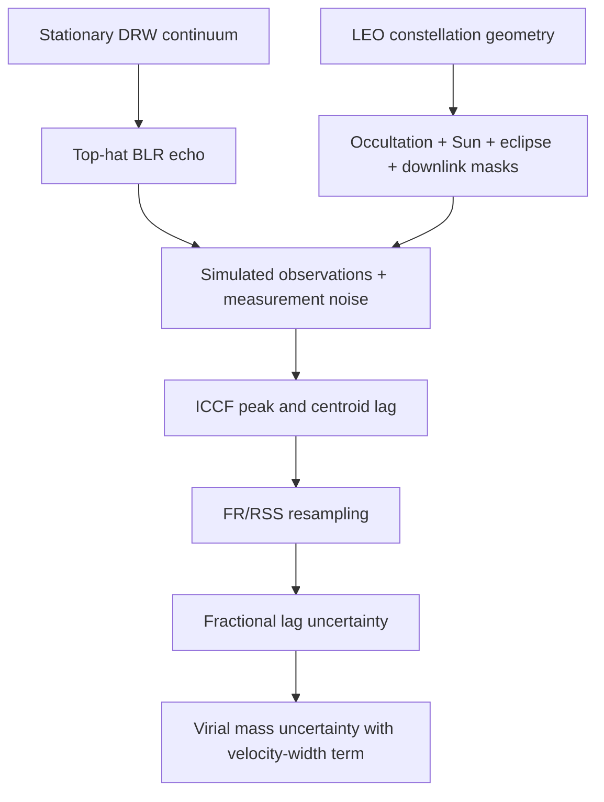
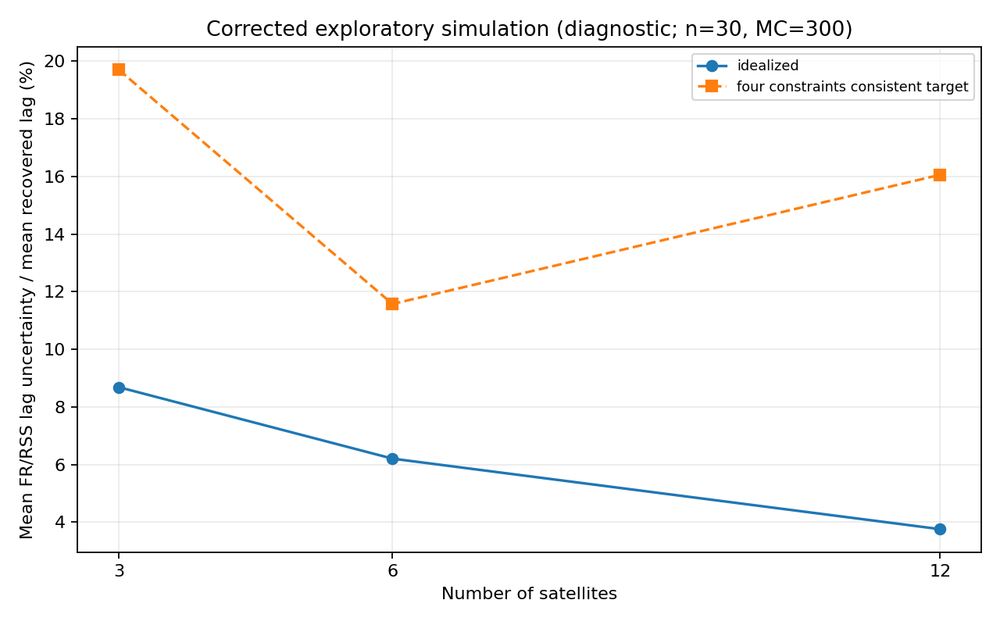

# CubeSat Constellations for AGN Reverberation Mapping

**Research code and independently labeled numerical reanalysis**  
**Author:** Aisha Shermatova  
**Associated manuscript:** [*Cadence, CubeSats, and Certainty: How Constellation Size Affects Reverberation-Mapped Black Hole Mass Uncertainty*](paper.pdf)

> **Scientific status:** This repository contains the original manuscript and a **revised implementation** of the simulation. The corrected code does **not** reproduce the manuscript's numerical tables. Specifically, the original DRW variability scale and endpoint handling were inconsistent, and the original orbital model mixed independently specified sky-target geometries. We preserve the original source and document each change. The new outputs below are **exploratory reanalysis**, not verified manuscript reproduction or independent observational validation.

## Research question

How does increasing a CubeSat constellation from 3 to 6 to 12 spacecraft affect uncertainty in reverberation-mapped AGN broad-line region time lags, particularly when the visibility model includes realistic operational constraints?

### Computational pipeline



The observation schedule is generated for assumed uniform cadence `2 days / N` and filtered by the operational visibility model. The astrophysical target sky position used by the corrected four-constraint model is the same in Sun-avoidance and Earth-occultation calculations. All solar, thermal, buffer, and instrumental thresholds are illustrative, not mission-qualified values.

## Quick start

Python 3.10 or newer recommended. Commands below run from this repository directory.

```bash
python -m venv .venv
# Windows PowerShell: .venv\Scripts\Activate.ps1
# macOS / Linux: source .venv/bin/activate
python -m pip install -r requirements.txt
python -m pytest -q tests
python run_corrected_experiments.py --mode smoke
```

Results and figures appear under `results/smoke/`. Numba accelerates the ICCF evaluation; its output is checked against the original NumPy formulation in the regression tests. If Numba is unavailable, the reference ICCF implementation remains usable, but slower.

### Experiment modes

| Command | Realizations per configuration | FR/RSS trials per realization | Intended use |
|---|---:|---:|---|
| `python run_corrected_experiments.py --mode smoke` | 4 | 40 | Confirm the workflow runs; **not** statistical evidence |
| `python run_corrected_experiments.py --mode diagnostic` | 30 | 300 | Exploratory reanalysis |
| `python run_corrected_experiments.py --mode full` | 100 | 1,200 | High-cost corrected simulation, closer to manuscript-scale settings |
| `python run_sensitivity_diagnostic.py` | 6 | 100 | Very small illustrative sensitivity experiment |

The `full` command runs baseline **and** four-constraint analyses at 100 × 1,200 for 3/6/12 satellites. It is intended for a workstation or longer compute allocation. Its completion is **not claimed** in this repository. The original paper's sensitivity studies and Monte Carlo convergence are described in `paper.pdf`; their original scripts are preserved, but were not completely rerun after the corrections.

### Recorded corrected outputs

The following are new code-generated **diagnostic** results (30 realizations × 300 FR/RSS trials), not the historical paper tables:

| Satellites | Idealized fractional lag uncertainty | Four-constraint fractional lag uncertainty |
|---:|---:|---:|
| 3 | 8.69% | 19.71% |
| 6 | 6.20% | 11.57% |
| 12 | 3.75% | 16.06% |

These results are sensitive to sampling, code corrections, and the chosen physical assumptions. **In the diagnostic four-constraint experiment, uncertainty rises from 6 to 12 satellites**, so the corrected run does not establish the monotonic diminishing-returns finding reported in the manuscript. Larger-scale reruns and model refinement are required.



For exact machine-readable values and provenance, see [`results/diagnostic/results_table.csv`](results/diagnostic/results_table.csv), [`run_metadata.json`](results/diagnostic/run_metadata.json), and the associated figure files. The 4-realization smoke output is separately labeled and must not be cited as substantive science.

## Numerical methods and assumptions

- **DRW/OU continuum:** characteristic damping time 50 days and `SF_inf=0.20`. Under the explicitly adopted structure-function convention, stationary flux standard deviation is `SF_inf/sqrt(2) ≈ 0.1414`. If the manuscript intended a 20% stationary RMS rather than a 20% *asymptotic structure function*, the parameter convention needs further reconciliation.
- **Broad-line region:** 10-day true lag, 4-day top-hat echo, illustrative line scaling and scatter. Finite window boundary values are extended instead of zero-padded; a physically modeled pre-window history remains future work.
- **Cadence:** 3, 6, 12 satellites; nominal observation spacing `2 / N` days over 120 days.
- **Orbit:** circular 500-km orbit, fixed inertial geometry and evenly spaced satellites in one plane; period approximately 94.5 minutes. Additional masks: 45° Sun exclusion, 10-minute eclipse recovery, single 40°N ground station, 10° minimum downlink elevation, six-hour onboard buffer. No propagated perturbations, deployable spacecraft hardware or realistic mission scheduling model.
- **Lag retrieval:** two-way interpolated cross-correlation (ICCF); centroid of all above-threshold points at ≥80% of peak. This simple rule can behave poorly for multimodal correlations.
- **Uncertainty:** flux randomization/random-subset sampling (FR/RSS) Monte Carlo. Replicated samples use unique retained indices; results can differ under other common FR/RSS implementations.
- **Mass conversion:** virial estimate `M = f c τ ΔV²/G` using assumed velocity width 3,000 km/s, 10% velocity-width uncertainty, and fixed virial factor 1.4. Fractional lag uncertainty and mass uncertainty are **different quantities**.

## What changed from the manuscript code?

See [VALIDATION_REPORT.md](VALIDATION_REPORT.md) for executed tests and results and [CHANGELOG_RESEARCH.md](CHANGELOG_RESEARCH.md) for a detailed audit and [`original_source/original_python_scripts.zip`](original_source/original_python_scripts.zip) for the untouched original Python implementation. Major changes:

1. Corrected stationary DRW innovation variance; validated analytic variance and autocorrelation.
2. Corrected the zero-padding artifact in top-hat convolution.
3. Changed full-constraint MC default from 300 to 1,200 in the legacy analysis script; the new runner exposes exact presets explicitly.
4. Introduced a consistent target direction between the Sun-avoidance and Earth-occultation calculations (`consistent_target_geometry=True`). The uploaded model's legacy geometry remains available for audit.
5. Replaced hard-coded manuscript-baseline values in comparison scripts with values loaded from fresh simulation output when available.
6. Added numerical regression tests, an optimized ICCF implementation verified against the original NumPy calculation, and manifest-backed experimental outputs.

**This is a reanalysis, not a corrigendum to the paper.** The revised outcomes should be discussed with the research mentor before using them in scientific abstracts or publication claims.

## Files

| File or folder | Purpose |
|---|---|
| `drw.py` | Corrected stationary DRW continuum and echo simulator |
| `iccf.py`, `fast_iccf.py` | ICCF and FR/RSS uncertainty; optional accelerated kernel |
| `simulation_core.py` | Common realization runners and mass calculations |
| `orbital_visibility.py` | Occultation, Sun angle, eclipse, downlink visibility |
| `run_corrected_experiments.py` | Reanalysis runner; smoke, diagnostic, and full settings |
| `run_sensitivity_diagnostic.py` | Low-cost sensitivity exploration |
| `run_simulation.py`, `generate_figures.py` | Original experiment structure, using corrected imported physics |
| `realistic_orbital_analysis.py`, `full_constraints_analysis.py` | Original structured orbital experiments, revised to remove hardcoded baseline comparisons |
| `sensitivity_analysis.py`, `mc_convergence_test.py` | Manuscript analysis scripts (high computational cost) |
| `tests/` | Physical and numerical regression tests |
| `results/` | Freshly executed corrected runs, metadata, tables, and plots |
| `paper.pdf` | Research manuscript (historical results, unchanged) |
| `original_source/` | Archived original source before code corrections |

## Reproducibility and limitations

The regression tests validate several analytical properties and the optimized ICCF implementation. They do **not** establish full manuscript reproduction, hardware feasibility, or validity against observational AGN light curves. The diagnostic results contain only 30 random realizations and may fluctuate substantially. Missing pre-campaign history, idealized schedules, fixed instrument parameters, and single-plane orbits limit physical interpretation.

The original manuscript and the corrected simulation currently disagree in important ways. **Do not cite the values in `results/diagnostic/` as the values in the paper.** Do not replace the manuscript's plots without scientific review, harmonized conventions, and fully rerun experiments.

## Responsible use

This code is shared for research inspection and computational education. It is not a flight-qualified design or validated astrophysical measurement pipeline. All scientific findings require further independent validation. The accompanying manuscript remains the author's work; no reuse license is granted by the absence of a `LICENSE` file.
